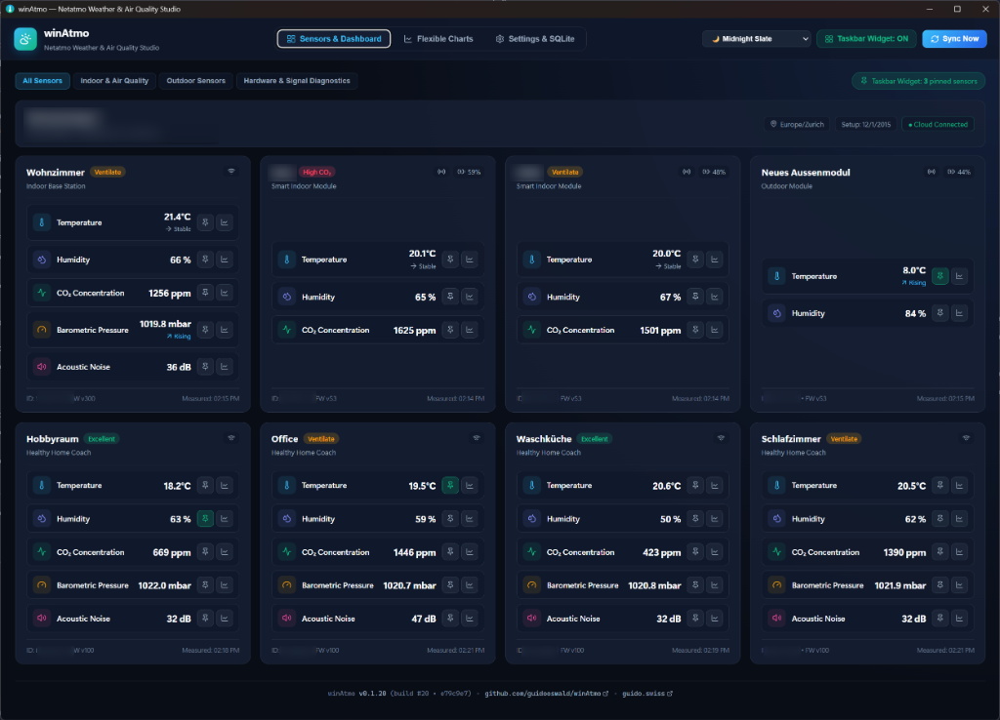
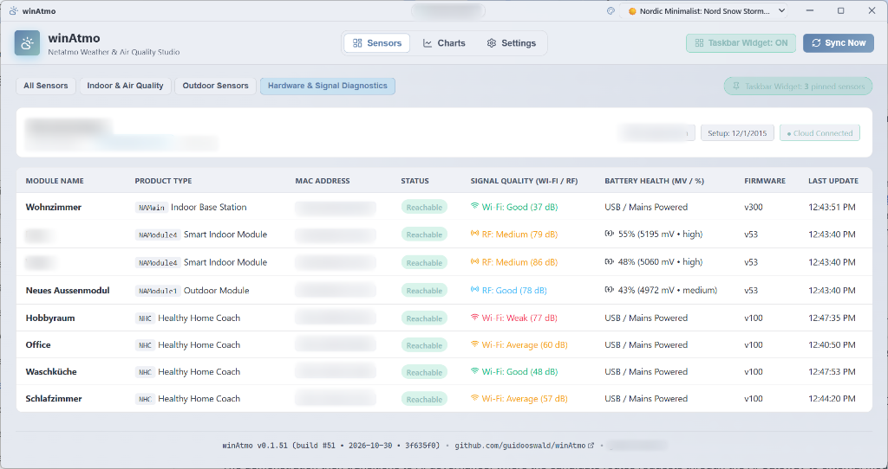
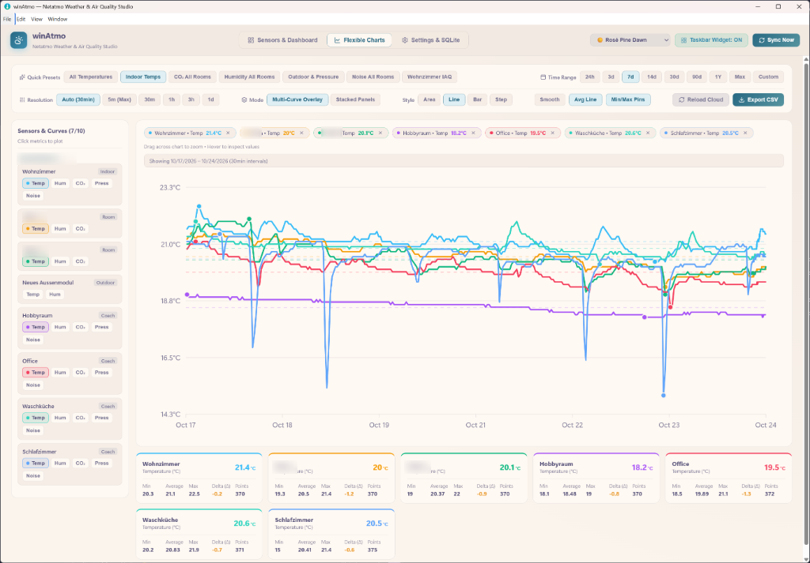
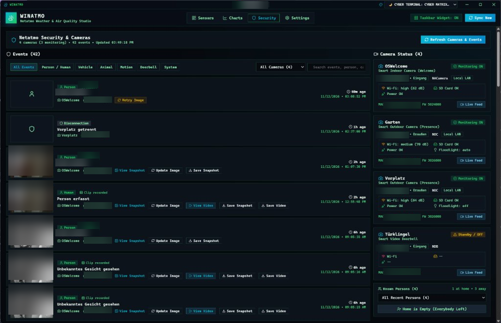
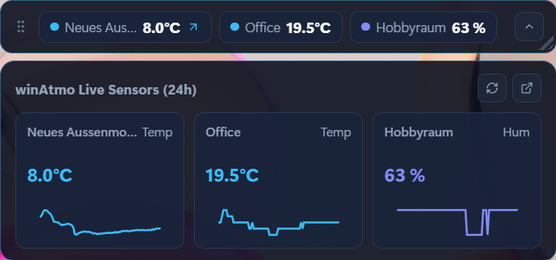
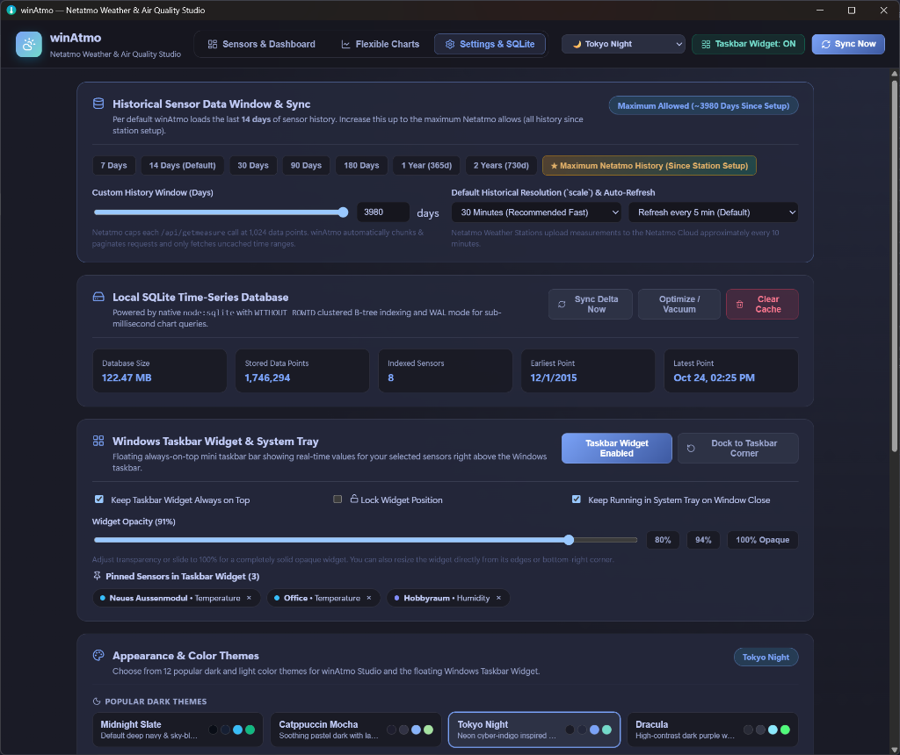
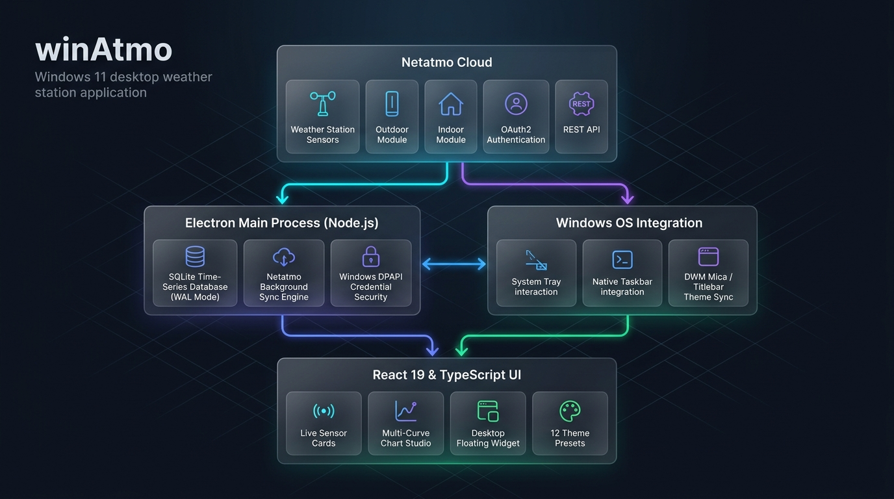

# winAtmo

<a href="https://apps.microsoft.com/detail/9P5LDB7WCKFG">
  
</a>

Native Windows desktop application for **Netatmo Personal Weather Stations** (`NAMain`, `NAModule1` Outdoor, `NAModule2` Wind Anemometer, `NAModule3` Rain Gauge, `NAModule4` Indoor Module), **Healthy Home Coach** (`NHC` Smart Indoor Air Quality Monitor), and **Netatmo Security Cameras & Doorbells** (`NACamera` Welcome, `NOC`/`NOC2` Presence, `NDB` Smart Video Doorbell, `NPC` Indoor Camera Advance), built with Electron, React, TypeScript, and native SQLite (`node:sqlite`).

---

## Screenshots

### Live Sensors & Air Quality Dashboard


### Hardware & Signal Diagnostics


### Flexible Multi-Curve Chart Studio


### Netatmo Security, Cameras, Live Feeds & Events


### Floating Windows Taskbar Widget (with 24h Mini-Sparkline Flyout)


### Settings, Local SQLite Time-Series Database & 12 Color Themes


---

## Architecture Overview



winAtmo employs a secure, high-performance multi-process architecture:
- **Netatmo Cloud & Camera Layer**: Weather Stations, Modules, Air Quality sensors, and Security Cameras/Doorbells synced via REST API, local LAN endpoints, and OAuth 2.0 / Web Login, plus an in-process localhost HLS media proxy (`securityMediaProxy` on `127.0.0.1`) for authenticated snapshot and `.m3u8`/`.ts` video streaming.
- **Electron Main Process (Node.js)**: Local high-throughput storage using native `node:sqlite` in WAL mode (`WITHOUT ROWID` for weather time-series plus cached `security_events`), DPAPI credential encryption at rest (`safeStorage`), and background auto-refresh poller (default 10-minute cycle).
- **Windows OS Integration**: Native translucent floating Taskbar Widget, System Tray background residency, and dynamic DWM title bar theme synchronization.
- **React 19 & TypeScript Studio**: Real-time sensor cards, custom zero-dependency SVG multi-curve charting studio (up to 10 curves with dual Y-axes), Netatmo Security dashboard with resizable `hls.js` video player, and 12 curated dark/light themes.

---

## Key Features

### 1. Web Login, OAuth 2.0 & DPAPI Security
- **One-Click Netatmo Web Login (`auth.netatmo.com` / `home.netatmo.com`)**: Opens an embedded Netatmo sign-in window, automatically intercepts the authenticated session token (`netatmocomaccess_token` / `Bearer` token), and supports silent background session renewal.
- **Official Netatmo Connect OAuth 2.0 (`api.netatmo.com/oauth2`)**: Full Authorization Code Grant flow with local loopback callback and automatic `refresh_token` rotation (`read_station read_homecoach`).
- **Windows DPAPI Encryption at Rest**: Encrypts stored tokens, session cookies, and OAuth secrets on disk using Electron's `safeStorage` (Windows DPAPI).
- **Personal Access Token & Built-in Demo Mode**: Paste developer tokens directly from [dev.netatmo.com](https://dev.netatmo.com/apidocumentation/weather) or explore the full UI offline using the built-in Demo Station.

### 2. Fast, Lightweight Local SQLite Time-Series Storage
- Powered by Node's native `node:sqlite` (`DatabaseSync`) in WAL (`Write-Ahead Logging`) mode—zero external database servers.
- Uses a clustered **`WITHOUT ROWID`** primary key `(module_id, metric, scale, ts)` for compact storage and sub-millisecond range queries across millions of data points.
- **Incremental Delta Sync**: Automatically tracks downloaded time spans per module and scale (`sync_log`), fetching only missing historical windows or new measurements since the last sync.
- **Configurable History Window**:
  - **Default**: **14 days** of historical sync (`historyDays: 14`).
  - **Configurable up to Netatmo's Maximum**: Presets and slider up to **Maximum Allowed (All History Since Station `date_setup`)** mode that paginates `/api/getmeasure` in 1,024-point chunks back to your station's initial setup date.

### 3. Flexible Multi-Curve Chart Studio
- **Multi-Sensor Comparison**: Plot up to **10 sensor curves** from any station or room simultaneously.
- **Sensor-Aware Quick Presets**: Dynamically generates presets tailored to your connected hardware (*All Temperatures*, *Indoor Temps*, *CO₂ All Rooms*, *Humidity All Rooms*, *Outdoor & Pressure*, *Noise All Rooms*, plus *Wind & Gusts* and *Rain* when present).
- **Overlay (Dual Y-Axis) & Stacked Sub-Charts**: Compare different physical units (e.g., Outdoor Temp `°C` on Left Axis vs. Barometric Pressure `mbar` on Right Axis) or view synchronized stacked panels.
- **Flexible Time Ranges & Resolutions**: Defaults to `7d` view with quick presets (`24h`, `3d`, `7d`, `14d`, `30d`, `90d`, `1Y`, `Max`) and custom date pickers, across `Auto`, `max` (~5 min), `30min`, `1hour`, `3hours`, and `1day` resolutions.
- **Visual Customization & Analysis**:
  - Area, Line, Bar, or Step-Line series styles.
  - Moving Average smoothing, Avg dashed lines, Min/Max pins, drag-to-zoom on the canvas, interactive crosshair inspector, summary statistics cards (`Latest`, `Min`, `Average`, `Max`, `Delta`, `Points`), and one-click **CSV Export**.

### 4. Netatmo Security Cameras, Live Feeds & Event Timeline
- **Camera Status & Live Feed Playback**: Lists connected indoor/outdoor cameras and doorbells (`NACamera`, `NOC`/`NOC2`, `NDB`, `NPC`) with monitoring state, Local LAN / VPN route indicator, Wi-Fi signal strength (`dB`), SD card status, power state, floodlight mode, and firmware version. Click **Live Feed** on any camera card to stream live HLS video (`{local_url|vpn_url}/live/index*.m3u8`) directly in the app.
- **Resizable HLS Video Player & Media Downloads**: Stream recorded camera event clips (`/vod/{video_id}/index*.m3u8`) or live feeds inside a resizable, maximizable `hls.js` modal powered by a local `127.0.0.1` loopback proxy. View full-resolution snapshots, manually refresh missing/expired event images, save snapshots, and download recorded event videos with a live segment & byte progress bar.
- **Filterable Event Timeline & Local SQLite Persistence**: Two-column layout with a fluid, window-scaling Events column filterable by event category (`All Events`, `Person / Human`, `Vehicle`, `Animal`, `Motion`, `Doorbell`, `System`), camera, person, and search text. Optionally caches security events in SQLite (`security_events`, toggleable and clearable in Settings) and performs unseen-only incremental background syncs on the shared **10-minute** default refresh cycle.
- **Known Persons & Home Presence Control**: Merges static person profiles with live `/api/homestatus` presence to show currently home vs. recently seen away family members, filter events by person, and notify Netatmo via **Home is Empty (Everybody Left)** (`POST /api/setpersonsaway`).
- **Debug Console Source Filtering**: Optional Debug Console tags and filters raw API telemetry separately by **Weather Station** and **Security** requests.

### 5. Floating Windows Taskbar Widget & 12 Themes
- **Live Taskbar & System Tray Sensor Reading**: Shows a live single sensor reading (e.g., outside temperature `14°` with semantic status colors) directly in your Windows taskbar tray instead of the static app icon. Fully customizable in settings to outside temp (default), indoor temp, CO₂, humidity, pressure, or any discovered station sensor.
- **Floating Single-Line Taskbar Bar**: Always-on-top, frameless rounded widget that auto-sizes to fit your pinned sensors on a single line, is freely resizable, and includes a **25%–100% Opacity slider**.
- **Smart Upward / Downward 24h Flyout**: Expands upwards when docked near the bottom taskbar and downwards when placed near the top of the screen, restoring its exact position on collapse.
- **12 Popular Dark & Light Color Themes**: Includes *Midnight Slate*, *Catppuccin Mocha*, *Tokyo Night*, *Dracula*, *Nord Polar Night*, *OLED Pitch Black*, *Alpine Daylight*, *Catppuccin Latte*, *Solarized Light*, *Nord Snow Storm*, *Rosé Pine Dawn*, and *GitHub Light* with native Windows dark/light title bar sync.

---

## Netatmo API Reference Implemented

| Endpoint | Usage in winAtmo |
| :--- | :--- |
| `GET /api/getstationsdata` | Loads Weather Station topology (`NAMain`, `NAModule1..4`), live `dashboard_data`, `date_setup`, `last_status_store`, `wifi_status`, `rf_status`, and `battery_vp` / `battery_percent`. |
| `GET /api/gethomecoachsdata` | Loads Healthy Home Coach (`NHC`) indoor air quality devices and live metrics. |
| `GET /api/getmeasure` | Fetches historical time-series (`scale`: `max`, `30min`, `1hour`, `3hours`, `1day`; `limit=1024`; `optimize=false`; `real_time=true`) with automatic pagination across arbitrary time ranges. |
| `GET /api/homesdata` (`gethomedata`) | Loads Netatmo home topology, Security cameras/doorbells (`NACamera`, `NOC`, `NDB`, `NPC`), modules, and known person profiles. |
| `GET /api/homestatus` | Fetches live camera monitoring status, stream `vpn_url` / `local_url`, Wi-Fi/SD/power/floodlight health, and live person presence (`out_of_sight`, `last_seen`). |
| `GET /api/getevents` (`geteventsuntil`) | Retrieves camera security timelines, sub-events, snapshots, and recorded clip references (`video_id`). |
| `POST /api/setpersonsaway` | Marks all persons in the selected home as away (**Home is Empty**). |
| `/api/getcamerapicture`, `/vod/*`, `/live/*` | Fetches event snapshots and proxies live and recorded HLS camera streams via winAtmo's local `127.0.0.1` loopback proxy. |
| `GET/POST /oauth2/*` | Official Netatmo Connect OAuth 2.0 Authorization Code & Refresh Token grant flows. |

---

## Installation & Getting Started

### Option 1: Microsoft Store (Recommended)

For the easiest install, zero dependencies, and automatic background updates, get **winAtmo** directly from the Microsoft Store:

<a href="https://apps.microsoft.com/detail/9P5LDB7WCKFG">
  
</a>

- **Direct Store Page:** [https://apps.microsoft.com/detail/9P5LDB7WCKFG](https://apps.microsoft.com/detail/9P5LDB7WCKFG)

---

### Option 2: Run from Source / GitHub

#### Prerequisites
- Windows 10 or Windows 11
- Node.js 22+

#### Installation & Build
```powershell
# Clone the repository
git clone https://github.com/guidooswald/winAtmo.git
cd winAtmo

# Install dependencies and launch
npm install
npm run build
npm start
```
Or double-click **`run.bat`** to build (if needed) and launch the native Windows app.

#### Development Mode (Hot Reload)
```powershell
npm run dev
```

---

## License & Privacy

- **License:** Released under the [MIT License](LICENSE) • Copyright © 2026 [Guido Oswald](https://guido.swiss)
- **Privacy Policy:** See [PRIVACY.md](PRIVACY.md) for data handling and security disclosures.

---

## Disclaimer

winAtmo is an independent, non-commercial, open-source project and is not affiliated with, endorsed by, or sponsored by Netatmo SAS or Legrand. "Netatmo" is a registered trademark of Netatmo SAS.
